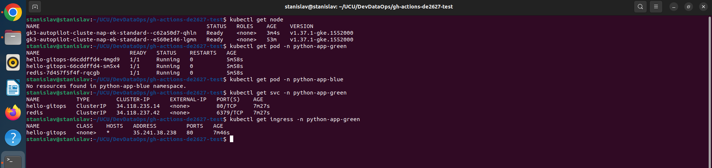
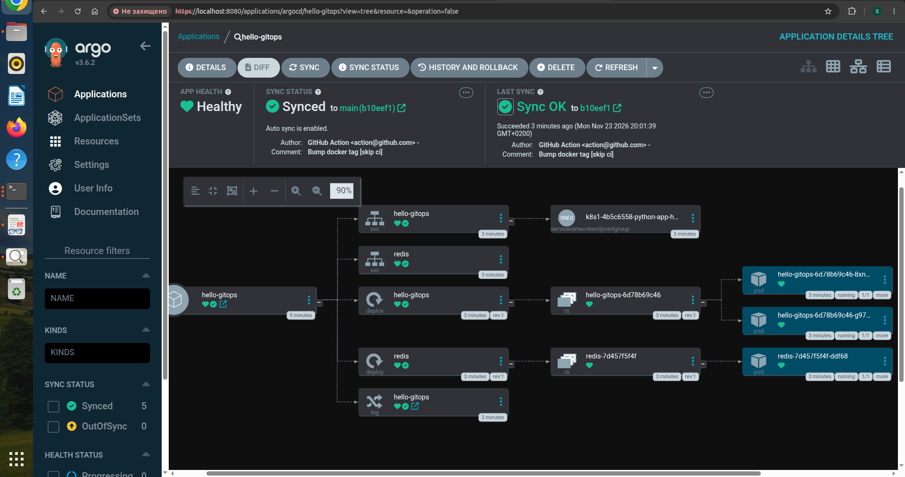
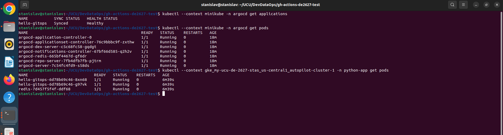

## Github Actions, Argo CD, GKE Homework

### Based on 
<https://github.com/docker/awesome-compose/tree/master/flask-redis>

### Screenshots
 
### 1. GitHub Actions CI/CD to the GKE cluster
 

 
### 2. Argo CD UI
 

 
### 3. Argo CD and GKE via kubectl
 

 
## Workflow runs
 
All workflow runs are available here: <https://github.com/stannast/gh-actions-de2627-test/actions>
